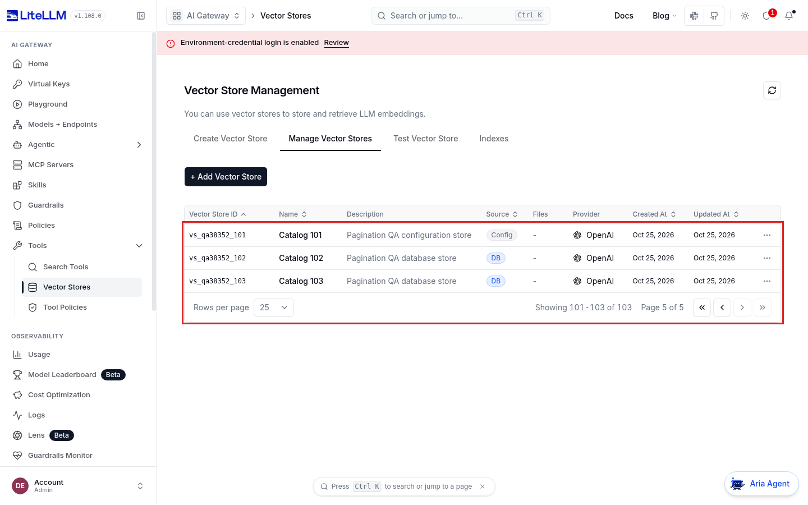

# Vector store pagination verification

Evidence for [LiteLLM #38352](https://github.com/BerriAI/litellm/issues/38352), captured on 2026-10-25 UTC

Before uses clean main `dddbaa803d6e9fcc862ea7a5412f771cb1ae040e`. After uses clean product commit `1188ea351c7701227452cb487434c8f840d88a9b`. The [source check](reports/final-source-check.json) records the complete nine-file diff and hashes, and the [eligibility check](reports/eligibility-final.json) records the open issue and overlap searches

The API calculated page metadata but returned every accessible store. The fix sorts the accessible catalog by ID, counts it, and returns the requested slice. The dashboard follows every management page so stores after the first 100 remain available

## Live setup

Each revision ran its actual proxy and production dashboard with a fresh PostgreSQL database at `http://127.0.0.1:41477`. The same [configuration](catalog-config.yml) declared 101 stores in reverse ID order, and the API created stores 102 and 103 in the database. The admin could see all 103 stores. One internal user key was granted IDs 003, 102 and 103, and a second key had no store grants

The live proxies used normal authentication without an enterprise entitlement override. Provider credentials were inert fixture text, and no vector search or model inference was sent. No provider behavior, external license validation, performance improvement, or concurrent-write snapshot consistency is claimed

The [API driver](drivers/api-probe.py) issued 56 authenticated list requests per revision. The [curl driver](drivers/curl-proof.py) separately executed 16 curl commands per revision, with exact commands, stdout and HTTP statuses in the [before transcript](reports/curl-report-baseline.json) and [after transcript](reports/curl-report-fixed.json). These are actual HTTP requests against the running proxy

## Observed API behavior

Every row was checked on both `/vector_store/list` and `/v1/vector_store/list`. IDs below omit the common `vs_qa38352_` prefix

| Request | Before | After |
| --- | --- | --- |
| Admin, page 1, size 2 | All 103 stores | IDs 001 and 002 |
| Admin, page 2, size 2 | All 103 stores again | IDs 003 and 004 |
| Admin, page 52, size 2 | All 103 stores | ID 103 |
| Admin, page 53, size 2 | All 103 stores | Empty page, count 103, 52 total pages |
| Admin, pages 1 and 2, size 100 | 103 records on each page | 100 records, then 3 |
| Page 0 or -1 | HTTP 200 | HTTP 400 with a positive-page error |
| Page size 0 or -1 | HTTP 400 | HTTP 400 |
| Restricted key, page 2, size 2 | All three granted stores | ID 103, count 3, two total pages |
| Key without grants | Empty, count 0 | Empty, count 0 |
| Seven pages of size 17, repeated twice | 721 entries for 103 unique stores per walk | All 103 IDs exactly once, in the same order |

Configuration ownership markers and credential masking were checked on every successful API response. Full results are in the [before API report](reports/api-report-baseline.json), [after API report](reports/api-report-fixed.json) and [comparison](reports/browser-comparison.json)

## Dashboard workflow

Playwright 1.58.1 drove headed Chromium 145.0.7632.6 at 1440x900 and a 390x844 touch viewport. Each revision completed the same seven captures using ordinary clicks or taps, without intercepted responses, forced clicks or injected layout changes

1. Log in at `/ui/login`, open `/ui/?page=vector-stores`, choose Manage Vector Stores, and sort by Vector Store ID
2. Go to the last table page and confirm stores 101 through 103 and `Showing 101-103 of 103`
3. Open `vs_qa38352_103` and confirm its name is `Catalog 103`
4. Return to the list, open Test Vector Store, and find `Catalog 103` in the picker
5. Select it without submitting a search query
6. Return to Manage Vector Stores, click Refresh, and confirm the full count
7. Reload the page and confirm the full count again

The dashboard already displayed the full catalog before the fix. This is a compatibility check for making the API authoritative. Before, each load received one unsliced response of 103 stores. After, each load received 100 stores and then three more. Both viewports completed all seven steps, with no page exceptions or HTTP 5xx responses

The matched last-page screenshots below have only a red outline added around the rows and pagination controls. The original images are retained alongside them

Before

After

[Before desktop recording](baseline/desktop.webm), [after desktop recording](fixed/desktop.webm), [before phone recording](baseline/phone.webm), [after phone recording](fixed/phone.webm)

All 28 raw screenshots, both annotated screenshots, and eight evenly spaced frames from each recording were visually inspected. This was sampled video inspection, not a review of every frame. The [visual report](reports/visual-inspection.json) and [frame contact sheets](visual-review) preserve the inspection scope

The phone layout has existing horizontal clipping after selecting the Test tab and wrapping pagination labels on both revisions. The tested taps still complete the workflow. Both runs report missing optional runtime-config and static-prefetch resources. The fixed run has the same nine 404 responses on each viewport, all at paths already seen before. These limitations are retained in the browser reports

## Regression tests and quality gates

| Check | Verified result |
| --- | --- |
| New backend cases on unchanged production code | Nine fail, one control passes |
| New frontend cases on unchanged production code | Two fail, three controls pass |
| New integration cases on unchanged production code | Six fail, four controls pass |
| Eight mapped backend files | 254 passed |
| Complete config-ownership integration file | 20 passed with real PostgreSQL, Redis and proxy processes |
| Seven selected frontend files | 284 passed, two expected failures |
| Final networking file after fixture cleanup | 63 passed |
| Frontend type tests | Eight passed across four files |
| Deliberate behavioral mutations | All five backend and four frontend mutations caught |
| Full `make format` and `make lint BASE_REF=origin/main LINT_JOBS=2` | Passed |
| Production TypeScript, Prettier, changed-file ESLint, unchanged lint budgets, knip | Passed |
| OpenAPI snapshot and `npm run gen:api` | Regenerated with no tracked changes |
| Production `npm run build` | Passed with all 2662 tracked dashboard files verified |

Exact commands and logs are in [backend checks](reports/backend-final.json), [mapped backend command](reports/backend-regression.json), [frontend checks](reports/ui-final.json), [selected frontend scope](reports/frontend-scope-checks.json), [mutations](reports/mutation-report.json), [schema regeneration](reports/api-types-check.json), [build](reports/ui-build.json) and [logs](logs)

The integration tests use the repository's existing isolated-service harness, including its test-only enterprise entitlement wrapper and upstream fixture. This is separate from the live browser and curl proxies above, which did not override entitlements. The integration report retains the pre-amend Git HEAD, while its tested working-tree production bytes match the final commit as documented in the source check

The whole-UI ESLint report has zero errors but exits 2 for unrelated stale suppression entries already present on main. Changed-file lint uses the repository CI flag, and the CI budget command passes without raising budgets. Only the touched networking suppression counts were reduced. The full backend type gate passes within unchanged ceilings, including zero E2E type errors

## Cleanup

Both temporary keys, both users and both database stores were deleted through the API on each revision. Both owned databases were dropped, proxy processes reaped and the QA port closed. See the [before cleanup](reports/live-cleanup-baseline.json) and [after cleanup](reports/live-cleanup-fixed.json)

Only the product branch is proposed upstream. This separate fork branch holds the screenshots, recordings, drivers and logs so reviewers can inspect the evidence without adding QA artifacts to the product diff
