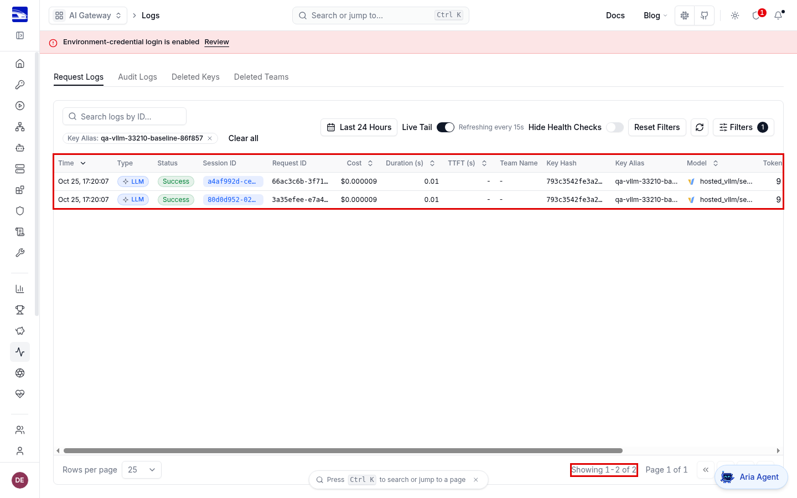
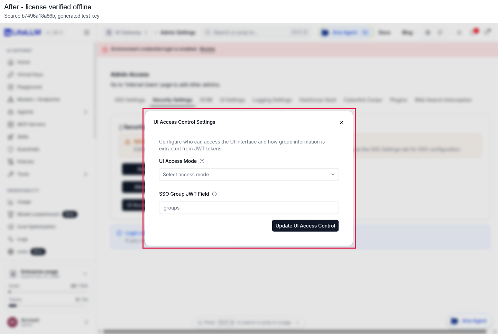
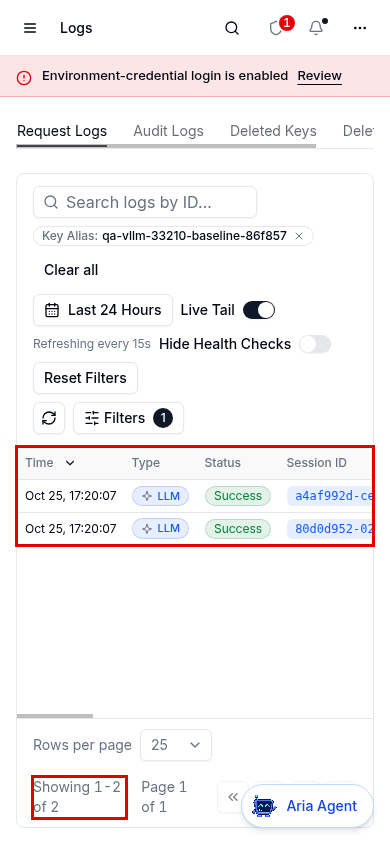
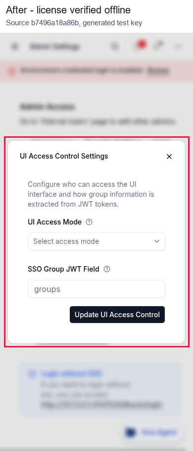

# Offline license verification, issue 26231

Before is `dddbaa803d6e9fcc862ea7a5412f771cb1ae040e`, the current upstream main used for the reproduction. After is `b7496a18a86bd7a0639513635738eb2dc9430047`

The proxy rejects a valid RSA-PSS license when the signed JSON contains dots. The fix reads the signature using the RSA key's byte width and checks the separator before verifying the signature

## Verification setup

Both revisions ran in the same Linux container with Python 3.12.13, PostgreSQL 16.10, and the unchanged production dashboard export from the before revision. The browser was headed Chromium 145.0.7632.6 through Playwright 1.58.1, at 1440x900 and 390x844 with mobile touch enabled

The licenses and RSA key were generated for this test. The same test public key was installed in both private verification worktrees, and the same signed bytes were used before and after. The production trust key is not part of the PR diff. No issued production license was available. The license server was unreachable through both a loopback host override and a closed HTTP proxy

The public key, signed payload metadata, input hashes and complete HTTP responses are included here. Private signing material and authentication tokens are excluded

## Reproduce the offline check

Use a disposable checkout for each source revision, with proxy dependencies and a local PostgreSQL database available. Build the dashboard from the before revision once and set `LITELLM_UI_PATH` to that same export for both runs

1. Run `python generate-fixtures.py` in this evidence directory to generate signed inputs and their test public key
2. Copy `test-public-key.pem` to the disposable checkout's `litellm/proxy/auth/public_key.pem`
3. Set `LITELLM_LICENSE` from `license-dotted.txt`, and set local `LITELLM_MASTER_KEY` and `DATABASE_URL` values
4. Make `license.litellm.ai` unreachable, then start the proxy with the included `config.yml` on port 41475
5. Run the curl command below, then repeat after restarting with each of the other four `license-*.txt` files
6. Restore the checkout's public key after testing with `git restore -- litellm/proxy/auth/public_key.pem`

```bash
export LITELLM_LOCAL_MODEL_COST_MAP=True
export HTTPS_PROXY=http://127.0.0.1:1
export HTTP_PROXY=http://127.0.0.1:1
export NO_PROXY=localhost,127.0.0.1
python -m litellm.proxy.proxy_cli --host 127.0.0.1 --port 41475 --telemetry false --config config.yml
```

In another terminal, use the same local master key

```bash
curl --fail-with-body -H "Authorization: Bearer $LITELLM_MASTER_KEY" http://127.0.0.1:41475/health/license
```

[All ten live results](api-results.md) show that the plain signed license remains accepted and expired or tampered inputs remain rejected. Dotted payloads, including an unpadded Base64 encoding, become accepted after the fix. Each successful reply preserves the signed expiry, feature list and seat/team limits

## Dashboard workflow

1. Sign in at `http://127.0.0.1:41475/ui/login` with the local admin credentials
2. Open `http://127.0.0.1:41475/ui/admin-panel`
3. Select Security Settings and click or tap UI Access Control
4. Before the fix, the valid dotted license gets the premium-only error. After the fix, the settings dialog opens
5. After the fix, select Restricted SSO Group and fill the group and JWT fields, then close without saving
6. Reload the page and repeat the action. The same expected result holds on both viewport sizes

These checks also verify the real login token's `premium_user` claim and the dashboard's actual `/health/license` response. The browser report excludes the token itself. No SSO provider sign-in or settings persistence is claimed









[Desktop before recording](before/desktop.webm), [desktop after recording](after/desktop.webm), [phone before recording](before/phone.webm), [phone after recording](after/phone.webm)

All 14 raw screenshots, four annotated screenshots and eight sampled frames from each recording were visually inspected. All four browser cases pass with no JavaScript exceptions or HTTP 5xx responses

## Automated checks

The final tests fail on the original verifier with six assertion failures and 38 passes. The fixed verifier and adjacent health endpoint tests pass on the current PR tip, 333 tests with 23 warnings in 15.72 seconds

```bash
python -m pytest tests/unit/proxy/auth/test_litellm_license.py tests/unit/proxy/health_endpoints/test_health_endpoints.py -q
make format
ruff format --check tests/unit/proxy/auth/test_litellm_license.py
make lint BASE_REF=origin/main LINT_JOBS=2
git diff --check origin/main...HEAD
```

The full lint target passes, including its format, strict-rule, type-discipline, test-quality, OpenAPI, type-budget, import and end-to-end type checks. The whole-tree type gate reports 105899 diagnostics within its merge-base ceilings. The separate end-to-end type check reports zero errors

Formatting, full lint and the mutation checks ran on `db1791631208a8d1065cdb393185404c51c26555`. That commit and the current tip have the identical content tree `b914489d35403656c9e129a04326b28e26ba341b`. The 333 affected tests, all ten live API checks and all four browser workflows were rerun on the current tip, and the screenshots and recordings here come from that fresh run

Four selected mutations are caught by assertion failures, splitting at the last dot, rounding the key width down, ignoring the separator, and removing RSA verification. They produce 1, 3, 1 and 3 failures respectively. The source was restored byte-for-byte before the passing test run. This is targeted mutation verification, not a whole-project mutation score

## CI retry

The [initial CI unit shard](https://github.com/BerriAI/litellm/actions/runs/40213438328/job/121229751012) failed the existing `test_token_counter_loads_a_custom_tokenizer_off_the_event_loop` timing assertion: 0.105 seconds of event-loop lag during a 0.409-second count. Running that exact test separately also fails on unchanged main, 0.205 seconds during 0.512 seconds, and the original PR tip, 0.332 seconds during 0.636 seconds. The local failure logs are included as [tokenizer-main.log](tokenizer-main.log) and [tokenizer-pr.log](tokenizer-pr.log)

GitHub denied the targeted rerun because it requires repository admin rights. One empty commit triggered fresh CI without changing code or tests. [ci-retry.json](ci-retry.json) records the revisions, identical content tree and measured timings; it does not claim the new CI run has passed

## Existing limitations

The phone tab labels overlap the settings panel on both revisions. The existing static export also emits runtime-config and prefetch 404s, 60 before and 42 after on desktop, nine on each phone run. The fixed run adds no new 404 paths. The dialog itself fits both viewports

The earlier proposal in [PR 26234](https://github.com/BerriAI/litellm/pull/26234) used the same signature-width approach and closed unmerged. This contribution applies it to the current verifier and mapped tests, including binary dots, non-byte-aligned RSA key sizes and invalid inputs
